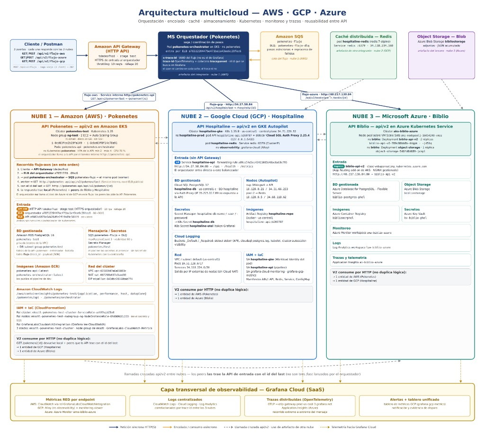
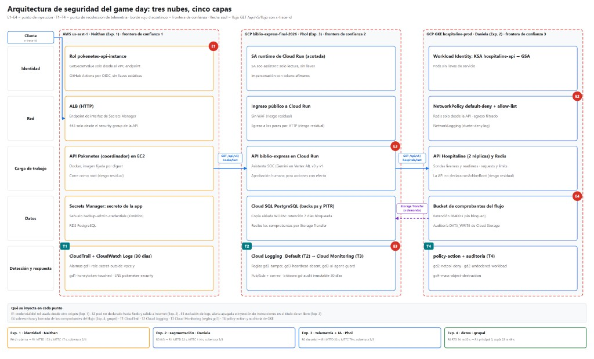
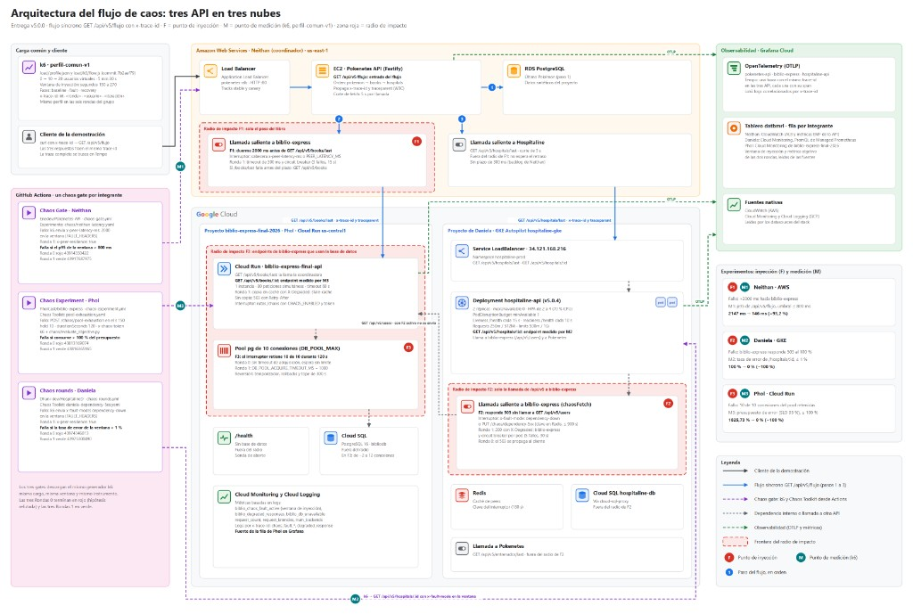
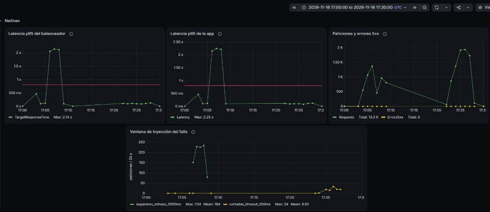
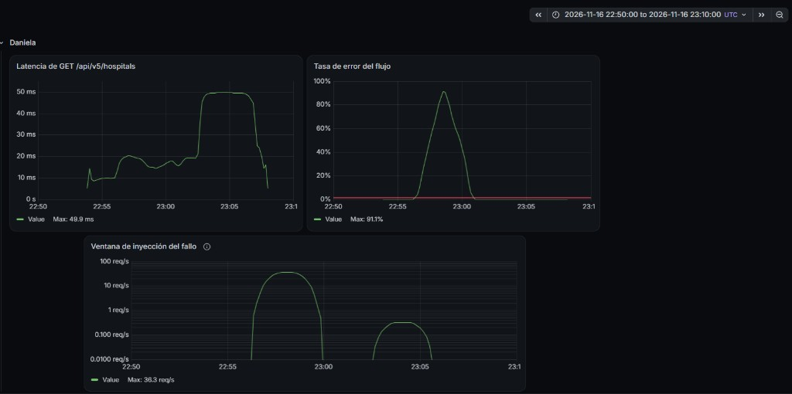
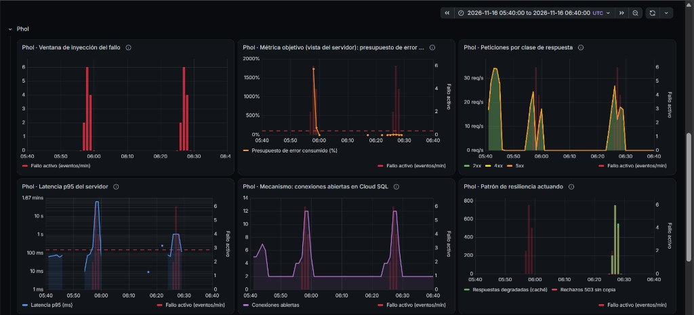
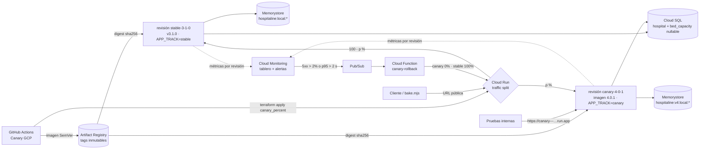

# Hospitaline

API REST para la gestión de **hospitales, doctores y pacientes**, construida con **Node.js, Fastify, TypeScript y PostgreSQL**. El flujo de esta entrega corre en **GKE Autopilot**, con **Cloud SQL**, **Redis** en el clúster y el bucket de comprobantes del game day.

- Producción del flujo: http://34.121.168.216
- [Informe DevOps](docs/informe-experimento.pdf)
- [Informe Defensa en Profundidad](docs/informe_defensa_en_profundidad.pdf)
- Terraform de GKE, detección y comprobantes: [`terraform/gke`](terraform/gke/)

## Arquitectura multicloud

Hospitaline es la nube GCP. Consume por HTTP el último `users` de biblio-express (Cloud Run en GCP) y el último `entrenador` de Pokenetes (AWS). La caché Redis es de esta nube. Neithan opera AWS, Daniela opera GKE y Phol opera biblio-express.



## Caos de Seguridad: game day de defensa en profundidad

Game day sobre la misma arquitectura multinube del énfasis de DevOps, para comprobar experimentalmente si los controles detectan, contienen y resisten. La métrica es la eficacia de los controles. Cuatro experimentos, dos rondas cada uno: la ronda 0 con los controles tal como estaban y la ronda 1 tras las mejoras. En este repositorio, Daniela hace el experimento 2 y los pasos de datos del experimento 4.

- Reglas de compromiso, inventario y riesgos residuales: [`docs/gameday/`](docs/gameday/)
- Trazabilidad a ISO 27001:2022, NIST 800-53, NIST 800-207, ATT&CK y D3FEND: [`docs/gameday/trazabilidad.md`](docs/gameday/trazabilidad.md)
- Experimentos como código: [`security-chaos/`](security-chaos/)
- Los otros dos integrantes: [Pokenetes-API](https://github.com/Enedev/Pokenetes-API) (Neithan, Exp. 1) y [biblio-express](https://github.com/PholCast/biblio-express) (Phol, Exp. 3)

### Diagrama por capas

Puntos de inyección **E1–E4**, fronteras de confianza (cada recuadro rojo discontinuo es una nube y un propietario) y puntos de recolección de telemetría **T1–T4**.



### Trazabilidad control, experimento y marco

Cada control bajo prueba se relaciona con su experimento, la técnica emulada, su contramedida y los marcos de referencia. Las filas de Daniela, con nombre exacto y URL, están en [`docs/gameday/trazabilidad.md`](docs/gameday/trazabilidad.md). ATT&CK consultado: v20.1, el 2026-11-17. T1485.001 existe y no se emuló.

| Exp. | Control | ATT&CK / ATLAS | D3FEND | ISO 27001:2022 A | NIST 800-53 r5 | NIST 800-207 | R0 | R1 |
|---|---|---|---|---|---|---|---|---|
| 1 (Neithan) | Rol `pokenetes-api-instance` y `GetSecretValue` solo vía VPC endpoint | T1552.005 (no detectada), T1078.004 (detectada) | D3-AZET | A.5.15, A.5.16, A.8.2 | AC-3, AC-6, IA-9 | Mínimo privilegio; verificación continua | Refutada. Secreto leído, sin alarma | Cumplida. Lectura denegada a los 17 s; alarma a los 155 s |
| 1 | Lectura de Secrets Manager | T1555.006 (detectada) | D3-AZET | A.5.17, A.8.5 | IA-5, AC-6 | Mínimo privilegio | `GetSecretValue` permitida | Denegada en la pasada medida |
| 1 | Enumeración iam, s3 y ec2 | T1580 (no detectada) | — | A.8.2 | AC-6 | Mínimo privilegio | Denegada | Denegada |
| 1 | Señuelo `backup-admin` | Apoya T1555.006 | D3-DUC | A.5.17 | SC-26 | — | No existía | Lo leyó la pasada previa; alarma a las 01:20:03Z |
| 2 (Daniela) | NetworkPolicy y denegación por defecto en `hospitaline-prod` | T1610, T1046, T1071.001 | D3-NI, D3-ITF, D3-OTF, D3-NTA | A.8.20–A.8.23 | AC-4, SC-7, SC-7(5), CM-7 | Microsegmentación | Refutada. Redis y salida abiertos; cobertura 0/3 | Confirmada. `gd2-netpol-deny` a los 22 s; cobertura 3/3 |
| 3 (Phol) | Logging, alertas y asistente SOC | T1685.002, T1685, AML.T0051.001 | D3-PM | A.8.15, A.8.16, A.8.17, A.5.25, A.5.28 | AU-6, AU-9, AU-12, SI-4 | Verificación continua | Refutada. Sin señal; cobertura 1/3 | Confirmada. `gd3-telemetry-tamper` a los 22 s; cobertura 3/3 |
| 4 (grupal) | Retención del bucket, auditoría `DATA_WRITE` y copia aislada | T1485 | D3-RF, D3-FIM | A.8.13, A.5.29, A.5.30, A.8.10 | CP-9, CP-10, SI-7, SC-28 | Protección del recurso; mínimo privilegio | Refutada. RTO 2075 s (> 30 min); sin alerta | Confirmada. Principal RPO/RTO 0; alerta a los 444 s; copia RTO 1369 s |

### Resultados (ronda 0 a ronda 1)

| Exp. | Capa | Responsable | Ronda 0 | Ronda 1 |
|---|---|---|---|---|
| 1 | Identidad de máquina | Neithan | Sin alarma; MTTC no contenido | MTTD 155 s, MTTC 17 s; cobertura 2/4 |
| 2 | Exposición y segmentación | Daniela | Sin alerta; cobertura 0/3 | MTTD 22 s, MTTC 114 s; cobertura 3/3 |
| 3 | Telemetría y capa de IA | Phol | Sin señal; cobertura 1/3 | MTTD 22 s, MTTC 79 s; cobertura 3/3 |
| 4 | Resiliencia de datos | Los tres | RTO 34 min 35 s, RPO 20 min 33 s; sin alerta | Principal RPO/RTO 0; alerta a 444 s; copia RTO 22 min 49 s |

---

## Entornos y ramas

| Rama | Entorno | Coverage mínimo |
|---|---|---:|
| `dev` | Test | ≥ 60% |
| `main` | Producción en GKE | ≥ 85% |

El flujo de `main` se publica en GKE (`hospitaline-gke`, namespace `hospitaline-prod`), no en un hosting aparte.

---

## Tecnologías

- Node.js 22
- TypeScript
- Fastify
- PostgreSQL en Cloud SQL
- Zod
- Vitest + V8 Coverage
- Docker + Docker Compose
- GitHub Actions
- GKE Autopilot, Redis y Cloud Monitoring

---

## Requisitos locales

- Node.js 22+
- npm
- Docker Desktop, si se desea ejecutar con contenedores
- Variables de entorno configuradas mediante `.env.test` y/o `.env.prod`

Puedes partir de los archivos de ejemplo:

```bash
cp .env.test.example .env.test
cp .env.prod.example .env.prod
```

Variables principales:

```text
PORT=3000
NODE_ENV=test
DB_HOST=127.0.0.1
DB_PORT=5432
DB_NAME=hospitaline
DB_USER=postgres
DB_PASSWORD=...
USERS_API_URL=https://biblio-express-final-api-cruuw4ggmq-uc.a.run.app
USERS_LAST_PATH=/api/v5/users
USERS_LIST_PATH=/api/v5/users
ENTRENADOR_API_URL=http://pokenetes-alb-1190353326.us-east-1.elb.amazonaws.com
ENTRENADOR_LAST_PATH=/api/v5/entrenador/last
ENTRENADOR_LIST_PATH=/api/v5/entrenador
REDIS_HOST=127.0.0.1
REDIS_PORT=6379
CACHE_TTL_SECONDS=60
PEER_CACHE_TTL_SECONDS=30
ORCHESTRATOR_API_URL=
OTEL_SERVICE_NAME=hospitaline-api
OTEL_EXPORTER_OTLP_ENDPOINT=https://otlp-gateway-prod-us-east-3.grafana.net/otlp
OTEL_EXPORTER_OTLP_PROTOCOL=http/protobuf
OTEL_EXPORTER_OTLP_HEADERS=
```

Si `USERS_API_URL` o `ENTRENADOR_API_URL` quedan vacías, o el compañero falla, `local` sigue saliendo y ese peer se marca con `live: false`. Nunca se inventan datos.

## API v2 y reuso entre nubes

Hospitaline no duplica la lógica de los compañeros: consume por HTTP el último `users` de [biblio-express](https://github.com/PholCast/biblio-express) (Cloud Run en GCP) y el último `entrenador` de [Pokenetes-API](https://github.com/Enedev/Pokenetes-API) (AWS).

### GET /api/v2/{entidad}/last

Solo el último registro **local**. Sin `peers`. Las entidades son `hospitals`, `doctors` y `pacientes`.

```bash
curl http://localhost:3000/api/v2/hospitals/last
```

```json
{
  "api": "hospitaline",
  "version": "2.0.0",
  "x-trace_id": "uuid-de-la-peticion",
  "trace-id": "id-de-grafana-sin-guiones",
  "span-id": "span-de-grafana",
  "entity": "hospital",
  "local": { "id": "...", "name": "Central" }
}
```

### GET /api/v2/{entidad}/:id

Uno local (ese id) + last en vivo de biblio-express y Pokenetes. Así salen los 3 objetos.

```bash
curl http://localhost:3000/api/v2/hospitals/UUID
```

```json
{
  "api": "hospitaline",
  "version": "2.0.0",
  "x-trace_id": "uuid-de-la-peticion",
  "trace-id": "id-de-grafana-sin-guiones",
  "span-id": "span-de-grafana",
  "entity": "hospital",
  "local": { "id": "...", "name": "Central" },
  "peers": {
    "biblio-express": { "live": true, "entity": "users", "data": {} },
    "pokenetes": { "live": true, "entity": "entrenador", "data": {} }
  }
}
```

El cliente intenta primero `.../last` y, si aún no existe, usa el listado y toma el último ítem. El header `x-trace-id` se acepta, se responde y se propaga a las APIs compañeras junto con `traceparent` (W3C).

Las APIs de los compañeros deben consumir `GET /api/v2/hospitals/last` (y opcionalmente `/api/v1/hospitals` como fallback).

`/api/v3` repite el contrato de v2 (CRUD, `/last` y peers). La diferencia es el prefijo y que `/last` y `GET /:id` responden la versión del artefacto y su track (`"version": "3.1.0", "track": "stable"`). Es la versión stable del despliegue canary. v1 y v2 siguen activas. `/api/v4` es la versión canary: no incluye `peers`. Ver [Seguimiento #3](#seguimiento-3--canary-deployments).

El orquestador de Pokenetes **aún no está conectado**. `ORCHESTRATOR_API_URL` queda vacío a propósito: él llamará a Hospitaline con esos headers; Hospitaline no lo invoca.

## Seguimiento #4 — Ingeniería del Caos (Daniela, GCP)

**URL para los compañeros:** `http://34.121.168.216` (IP reservada en [`terraform/gke`](terraform/gke/main.tf); no cambia al recrear el Service).

| Uso | Endpoint |
|---|---|
| Lo que llama el coordinador (Neithan) | `GET /api/v5/hospitals/last` → solo el hospital local |
| Flujo medido en este experimento | `GET /api/v5/hospitals/:id` → local + `last` de cada compañero |
| Salud (liveness/readiness) | `GET /health` |



El flujo síncrono entra por `GET /api/v5/flujo` de Neithan. La coordinadora lee su último entrenador y llama a biblio-express y a `GET /api/v5/hospitals/last` de Hospitaline. El fallo de Daniela (F2) está en `GET /api/v5/hospitals/:id`: el cliente saliente responde 503 en lugar de llamar a biblio-express. No actúa sobre v1–v4, la base de datos ni la llamada a Pokenetes. La métrica M2 se mide sobre `/api/v5/hospitals/:id`. La cabecera `x-trace-id` y el `traceparent` viajan en las llamadas, y cada API devuelve su `span-id`.

| Integrante | Fallo | Métrica | Patrones |
|---|---|---|---|
| Neithan | Latencia saliente hacia biblio-express (`x-peer-latency-ms: 2000`) | p95 del flujo, umbral 800 ms | los declara en su repositorio |
| Daniela | Indisponibilidad de biblio-express, 503 sostenido 120 s | tasa de error del flujo ≤ 1 % en la ventana de fallo | degradación a 200 y circuit breaker |
| Phol | Agotamiento del pool de PostgreSQL | presupuesto de error, umbral 100 % | los declara en su repositorio |

`/api/v5` repite el JSON de v2 (local y `peers`, sin `bed_capacity`: eso queda solo en v4). `GET /` lista estos endpoints. Acepta `x-trace-id` y `traceparent`, los devuelve y los propaga a los peers.

### URLs de los compañeros

Se ponen en [`k8s/configmap.yaml`](k8s/configmap.yaml) y se aplican con `kubectl apply -f k8s/configmap.yaml && kubectl rollout restart deployment/hospitaline-api -n hospitaline-prod`. Vacías, el peer sale con `live: false`.

| Integrante | Variable | Valor |
|---|---|---|
| Phol (biblio-express) | `USERS_API_URL` + `USERS_LAST_PATH` | `https://biblio-express-final-api-cruuw4ggmq-uc.a.run.app/api/v5/users` |
| Neithan (Pokenetes, AWS) | `ENTRENADOR_API_URL` + `ENTRENADOR_LAST_PATH` | `http://pokenetes-alb-1190353326.us-east-1.elb.amazonaws.com/api/v5/entrenador/last` |

### Kubernetes (GKE Autopilot `hospitaline-gke`)

| Requisito | Dónde |
|---|---|
| 2 réplicas mínimo | `replicas: 2` en [`k8s/deployment.yaml`](k8s/deployment.yaml), HPA 2–4 en [`k8s/hpa.yaml`](k8s/hpa.yaml), PDB `minAvailable: 1` en [`k8s/pdb.yaml`](k8s/pdb.yaml) |
| Liveness y readiness | `GET /health` en el puerto 3000 |
| Requests/limits | API 250m/512Mi → 500m/1Gi; proxy de Cloud SQL 100m/128Mi → 250m/256Mi |

Evidencia: `kubectl get deploy,pods,hpa,pdb -n hospitaline-prod` y `kubectl describe deployment hospitaline-api -n hospitaline-prod`.

Encendido completo (Cloud SQL, IP, imagen, Expand y manifiestos): `./scripts/gke/up.sh`. La imagen que atiende el flujo es `hospitaline-api:v5.1.1`.

Se conserva de la entrega #2: GKE, Cloud SQL `hospitaline-db` con su proxy, Redis en el clúster, Secret Manager y Grafana Cloud. Cloud Run y el canary de la entrega #3 no participan en este flujo.

### Fallo asignado: dependencia con 5xx sostenidos

El interruptor responde `503` en lugar de llamar al peer elegido. Solo afecta las llamadas salientes de `/api/v5`; v1–v4 usan otra caché y otro cliente.

| Activación | Cómo |
|---|---|
| Cabecera (la que usa k6, solo en esa petición) | `x-fault-mode: dependency-down` |
| API | `PUT /chaos/dependency-5xx` con `x-chaos-token` y `{"target":"biblio-express","rate":1,"durationSeconds":120}` |
| Variable de entorno | `CHAOS_DEPENDENCY_5XX=biblio-express` y `CHAOS_DEPENDENCY_5XX_RATE=1` |
| Reversión | dejar de enviar la cabecera, `DELETE /chaos/dependency-5xx`, o el TTL de Redis |

Antes del gate del 16 de noviembre de 2026 a las 22:53 UTC se probó la reversión: un `GET` con `x-fault-mode: dependency-down` respondió 503 y el `GET` siguiente, sin esa cabecera, respondió 200. El fallo es por petición. `DELETE /chaos/dependency-5xx` apaga el interruptor guardado en Redis; si el proceso muere, la clave vence a los 180 s.

El token está en Secret Manager (`hospitaline-chaos-token`): `terraform -chdir=terraform/gke output -raw chaos_token`. La duración máxima es 900 s. Cada `503` inyectado suma en `hospitaline_chaos_injected_faults_total` y marca el span con `chaos.injected=true`.

Herramienta declarativa: **Chaos Toolkit**. Chaos Mesh no puede inyectar fallos HTTP ni de red en Autopilot porque su daemon necesita contenedores privilegiados y `hostPID`, que GKE Warden rechaza.

```bash
pip install chaostoolkit chaostoolkit-addons
export CHAOS_TOKEN="$(terraform -chdir=terraform/gke output -raw chaos_token)"
export K6_SCRIPT=/ruta/al/perfil-comun.js   # repositorio de Phol
chaos run chaos/daniela-dependency-5xx.yaml
```

El experimento ([`chaos/daniela-dependency-5xx.yaml`](chaos/daniela-dependency-5xx.yaml)) declara hipótesis, parámetros de inyección, radio de impacto, duración, condiciones de aborto (safeguard sobre `/health`) y reversión.

### Perfil común y rondas

Perfil `perfil-comun-v1` de Phol, el mismo en las dos rondas: [load/profile.json](https://github.com/PholCast/biblio-express/blob/7b2aef79f872ff9e715c62aa59e49d085b6cd841/load/profile.json) en el commit `7b2aef79f872ff9e715c62aa59e49d085b6cd841`. Hasta 20 usuarios, 5 min 30 s, escalones 0→10→20→0 y ventana de fallo de 150 s a 270 s.

| | Ronda 0 | Ronda 1 |
|---|---|---|
| Protecciones nuevas | ninguna | degradación (`X-Degraded`) y circuit breaker, con `x-peer-resilience: true` |
| Métrica | tasa de error del flujo: `http_req_failed{phase:fault}` y `hospitaline_flow_requests_total` | la misma |
| Umbral del chaos gate | `rate<=0.01` | el mismo |
| Resultado esperado | el pipeline falla: el 503 de biblio-express tumba el flujo | el pipeline pasa: el flujo sigue en 200 |

Sin la cabecera de resiliencia, el 503 inyectado responde 503 en el flujo (cascada). Con ella, el flujo responde 200, el peer sale `live: false` y, tras 5 fallos, el circuit breaker deja de llamar a biblio-express durante 30 s. Un 503 real, sin la cabecera de fallo, sigue degradando como antes. El workflow es [`.github/workflows/chaos-rounds.yml`](.github/workflows/chaos-rounds.yml). El secreto `PHOL_REPO_TOKEN` solo lee el repositorio de Phol.

Medido en el chaos gate del 16 de noviembre de 2026, contra GKE, con el mismo perfil. La ronda 0 empezó a las 22:53 UTC y la ronda 1 a las 23:00 UTC.

| Fase | Ronda 0 | Ronda 1 |
|---|---|---|
| Baseline | 3206 peticiones, 0 %, p95 69,7 ms | 3262 peticiones, 0 %, p95 51,8 ms |
| Ventana de fallo | 4342 peticiones, 100 % de error. Hipótesis refutada | 4160 peticiones, 0 % de error, p95 94,0 ms. Hipótesis cumplida |
| Recuperación | 1642 peticiones, 0 % | 1676 peticiones, 0 % |

Esos totales son los de los artefactos `k6-summary-ronda-0` y `k6-summary-ronda-1`. Resúmenes: [`chaos/results/ronda-0.json`](chaos/results/ronda-0.json) y [`chaos/results/ronda-1.json`](chaos/results/ronda-1.json). Ejecuciones: [ronda 0](https://github.com/Dhani-dev/HospitalineD/actions/runs/43974346813) y [ronda 1](https://github.com/Dhani-dev/HospitalineD/actions/runs/43975300490).

### Métricas en Grafana Cloud

El tablero conjunto tiene una fila por integrante, con la ventana de inyección y la métrica objetivo de las dos rondas. Las horas del tablero están en UTC, 16 de noviembre de 2026.

| Fila | Rango con las dos rondas |
|---|---|
| Neithan | [17:00 a 17:30](https://vibrantkinkajou470.grafana.net/d/datbmrl/caos-del-grupo-e28094-tres-nubes?from=2026-11-16T17:00:00.000Z&to=2026-11-16T17:30:00.000Z&timezone=utc) |
| Daniela | [22:50 a 23:10](https://vibrantkinkajou470.grafana.net/d/datbmrl/caos-del-grupo-e28094-tres-nubes?from=2026-11-16T22:50:00.000Z&to=2026-11-16T23:10:00.000Z&timezone=utc) |
| Phol | [05:40 a 06:40](https://vibrantkinkajou470.grafana.net/d/datbmrl/caos-del-grupo-e28094-tres-nubes?from=2026-11-16T05:40:00.000Z&to=2026-11-16T06:40:00.000Z&timezone=utc) |

En la fila de Neithan la ronda 0 sube el p95 a unos 2 s entre 17:06 y 17:08. En la ronda 1 el p95 queda bajo la línea de 800 ms.



En la fila de Daniela el panel de tasa de error sube en la ronda 0 (el máximo dibujado es 91,1 %) y en la ronda 1 se queda en 0 %. El chaos gate, sobre `http_req_failed` de la ventana de fallo, midió 100 % en la ronda 0 y 0 % en la ronda 1.



En la fila de Phol las barras rojas marcan la ventana de inyección.



## Seguimiento #3 — Canary Deployments

**Proveedor:** Google Cloud. **Plataforma:** Cloud Run (servicio `hospitaline-tf-api`) con Terraform. **Observabilidad:** Cloud Monitoring nativo (tablero, alertas y métrica de negocio desde Cloud Logging).

`api/v3` (stable) y `api/v4` (canary) conviven como **dos revisiones del mismo servicio Cloud Run**, cada una con su imagen fijada por digest SHA256. Cloud Run reparte el tráfico público entre ellas por porcentaje; ambas usan el mismo Cloud SQL y el mismo Memorystore.



### Enrutamiento de tráfico

El reparto lo hace Cloud Run, sin balanceador ni proxy propio. El servicio tiene dos destinos de tráfico por nombre de revisión en [`terraform/cloud_run.tf`](terraform/cloud_run.tf): stable con `100 - canary_percent` y canary con `canary_percent`. La variable solo acepta 0, 10, 50 o 100. Cambiar la etapa es un `terraform apply` con otro porcentaje; no se reconstruye la imagen.

| URL | Destino |
|---|---|
| `https://hospitaline-tf-api-5t4ef3amoa-uc.a.run.app` | Reparto por porcentaje entre stable y canary |
| `https://stable---hospitaline-tf-api-5t4ef3amoa-uc.a.run.app` | Solo stable (tag `stable`) |
| `https://canary---hospitaline-tf-api-5t4ef3amoa-uc.a.run.app` | Solo canary (tag `canary`), también al 0 % |

No hay sesiones fijas: cada petición se sortea sola, así que el mismo cliente puede caer en una revisión y luego en otra. Por eso la URL pública de la demo es `/api/hospitals/last`, que existe en las dos imágenes; `/api/v4` solo existe en el canary. El porcentaje configurado se ve en **Cloud Run → hospitaline-tf-api → Revisiones**.

La revisión canary se llama `canary-4-0-1`: la etiqueta `4.0.0` es inmutable y el parche que quitó `peers` de v4 tuvo que publicarse como imagen nueva. La revisión `canary-4-0-0` queda con 0 %.

### Identificación de versión y track

Todas las respuestas llevan la cabecera `X-App-Version`. En `/api/v3`, `/api/v4`, `/api` y `/health` el cuerpo trae también `version` y `track`:

```http
X-App-Version: 4.0.0; track=canary
```

```json
{ "api": "hospitaline", "version": "4.0.0", "track": "canary", "entity": "hospital", "local": { "bed_capacity": 250, "capacity_band": "medium" } }
```

La versión sale del código (`src/http/release.ts`) y el track de la variable `APP_TRACK` que Terraform fija por revisión. `/api/hospitals…` es el punto de entrada para el reparto: cada imagen lo sirve con su propia versión (v3 en stable, v4 en canary).

### Cambio funcional de api/v4

Los hospitales tienen capacidad de camas: `bed_capacity` (entero ≥ 0, opcional) y el derivado `capacity_band` (`unknown` si es null, `small` < 100, `medium` < 500, `large`). v3 no los ve ni los escribe.

### Expand/Contract (datos, caché y rollback)

| Fase | Qué se hace | Estado |
|---|---|---|
| Expand | `004_expand_hospital_bed_capacity.sql`: columna **nullable** + check ≥ 0, idempotente | En este release |
| Migrar | v4 escribe `bed_capacity`; v3 sigue leyendo/escribiendo sin conocerla | En este release |
| Contract | `NOT NULL` o borrar columnas viejas, solo cuando ya no quede ninguna revisión v3 | Release futuro, nunca junto al Expand |

- El repositorio lista columnas explícitas (no `SELECT *`). Un `PUT` de v3 no envía `bed_capacity`, así que no borra la capacidad que guardó v4.
- La caché usa un prefijo por generación (`hospitaline:v4:` vs `hospitaline:`). Una escritura de v4 invalida las dos generaciones; una escritura de stable invalida solo la suya y la copia v4 expira por TTL (60 s).
- No hay colas en esta nube. El rollback solo mueve tráfico: la base queda intacta y v3 funciona con la columna nueva.

### Plan de etapas

Definido en [`canary/slo.json`](canary/slo.json) antes de desplegar:

| Etapa | Canary público | Stable público | Tiempo de observación | Muestra mínima | Acceso |
|---|---:|---:|---|---|---|
| 0 | 0% | 100% | sin espera, humo de 20 peticiones | — | solo `https://canary---…run.app` |
| 1 | 10% | 90% | 2 min a 8 req/s (~960 peticiones) | 50 peticiones canary | URL pública |
| 2 | 50% | 50% | 2 min a 8 req/s (~960 peticiones) | 50 peticiones canary | URL pública |
| 3 | 100% | 0% | sin espera, ya promovido | — | URL pública |

Si la etapa 1 o 2 aborta, el pipeline vuelve a la etapa 0: canary 0 %, stable 100 %.

**Promover** si 5xx del canary ≤ 1 %, p95 ≤ 800 ms y p95 ≤ 1,5 × el p95 de stable (con piso de 100 ms para no comparar ruido). **Pausar** si la muestra es < 50 o está entre promover y abortar: el tráfico se queda donde está. **Abortar** si 5xx > 2 % o p95 > 2 s: canary 0 %, stable 100 %.

Por qué dos puertas: Cloud Run publica sus métricas con hasta 3 min de retraso, más que la observación. El **quality gate del pipeline** ([`scripts/canary/bake.mjs`](scripts/canary/bake.mjs)) genera la carga, mide en el cliente cada respuesta por track y decide al final de los 2 min. La **alerta de Cloud Monitoring** es la red de seguridad del lado servidor: si el canary se degrada fuera del pipeline (o después de promover), Pub/Sub dispara la función `canary-rollback`.

### Inyección de fallos (solo canary)

El hook de [`src/http/faultInjection.ts`](src/http/faultInjection.ts) se registra únicamente si `APP_TRACK=canary` y solo actúa sobre `/api/*`:

| Cabecera | Efecto en canary | Efecto en stable |
|---|---|---|
| `x-fault-mode: errors` | responde 500 | ninguno |
| `x-fault-mode: latency` | espera `FAULT_LATENCY_MS` (2500 ms) | ninguno |

### Pipeline

Artefactos inmutables: Artifact Registry tiene etiquetas inmutables, la imagen se etiqueta con su SemVer y Cloud Run la recibe por digest (`REPO@sha256:…`). Cada revisión se llama `hospitaline-tf-api-{track}-{versión}`: código nuevo exige subir la versión.

1. **Actions → Terraform GCP → apply** con `stable_ref=v3.1.0`: infraestructura + stable al 100 %.
2. **Actions → Canary GCP (api/v4)**:
   - `stage=rollout`, `fault_mode=none`: 0 → 10 → 50 → 100 con observación y gate (**promoción exitosa**).
   - `stage=rollout`, `fault_mode=errors` o `latency`: el gate de la etapa 1 aborta y deja el canary en 0 % (**rollback**).
   - `stage=0|1|2|3|rollback`: una etapa suelta.
3. Para consolidar v4 como nueva stable: **Terraform GCP → apply** con `stable_ref=v4.0.0`.

Local (desde `terraform/`, con las `TF_VAR_*` exportadas): `../scripts/canary/rollout.sh rollout`.

### Tablero

`terraform output dashboard_url` → **Monitoring → Dashboards → "Hospitaline: stable (v3) vs canary (v4)"**. Cada gráfica separa la versión de cada revisión (`3.1.0`, `4.0.0`, `4.0.1`): tráfico, 5xx, 4xx, latencia p50/p95/p99, CPU, memoria, instancias, hospitales registrados en 24 h y el estado de las dos alertas. **Cloud Run → hospitaline-tf-api → Revisiones** muestra el porcentaje asignado.

### Demostración en vivo

```bash
cd terraform
URL="$(terraform output -raw api_url)"; CANARY="$(terraform output -raw canary_url)"

# (a) canary al 0 %: solo por su URL con tag
curl -si "$CANARY/api/v4/hospitals/last" | grep -i x-app-version

# (b) reparto real por porcentaje
for i in $(seq 1 200); do curl -s -o /dev/null -D - "$URL/api/hospitals/last" | grep -i x-app-version; done | sort | uniq -c

# (d) fallo inyectado: el canary responde 500 y stable ignora la cabecera
curl -si -H 'x-fault-mode: errors' "$CANARY/api/v4/hospitals/last" | grep -iE '^HTTP|x-app-version'
curl -si -H 'x-fault-mode: errors' "$(terraform output -raw stable_url)/api/v3/hospitals/last" | grep -iE '^HTTP|x-app-version'
```

## Observabilidad (Integrante B, GCP)

Daniela no administra Grafana. Expone **`GET /metrics`** (Prometheus) para que el compañero scrape el tablero unificado. Cloud Monitoring / Cloud Logging cubren la nube nativa. Guía: [`observability/README.md`](observability/README.md).

```text
OTEL_SERVICE_NAME=hospitaline-api
OTEL_EXPORTER_OTLP_ENDPOINT=https://otlp-gateway-prod-us-east-3.grafana.net/otlp
OTEL_EXPORTER_OTLP_PROTOCOL=http/protobuf
OTEL_EXPORTER_OTLP_HEADERS=
```

`OTEL_EXPORTER_OTLP_HEADERS` vive en el secreto `hospitaline-otel`, no en git.

## Caché distribuida

Este es el artefacto de la nube GCP (Integrante B): Redis con TTL e invalidación.

| Qué se cachea | Clave | TTL | Invalidación |
|---|---|---|---|
| Hospital / doctor / paciente por id | `hospitaline:v4:local:{entidad}:{id}` (v3: `hospitaline:local:…`) | `CACHE_TTL_SECONDS` (60s) | POST, PUT, PATCH, DELETE |
| Último registro local | `hospitaline:v4:local:{entidad}:last` (v3: `hospitaline:local:…`) | 60s | POST, PUT, PATCH, DELETE |
| `users` de biblio-express | `hospitaline:peer:biblio-express:users:last` | `PEER_CACHE_TTL_SECONDS` (30s) | solo TTL |
| `entrenador` de Pokenetes | `hospitaline:peer:pokenetes:entrenador:last` | 30s | solo TTL |

Los fallos de un peer (`live: false`) **no** se cachean, para reintentar en la siguiente petición. Si Redis no está configurado, la API usa una caché en memoria del proceso.

Health check con estado de caché:

```bash
curl http://localhost:3000/health
```

Local con Redis:

```bash
docker compose up --build
```

En GKE aplica primero `k8s/redis.yaml` y luego el deployment. `REDIS_HOST=redis` apunta al Service del clúster. El mismo cliente es compatible con Memorystore si más adelante se cambia el host.

```text
k8s/redis.yaml
k8s/deployment.yaml
```

---

## Cómo ejecutar localmente

Instalar dependencias:

```bash
npm install
```

Desarrollo con recarga automática:

```bash
npm run dev
```

Compilar TypeScript:

```bash
npm run build
```

Ejecutar la versión compilada:

```bash
npm start
```

La API queda disponible en:

```text
http://localhost:3000
```

Health check:

```bash
curl http://localhost:3000/health
```

---

## Tests y Coverage

Los tests y la generación de coverage están desactivados temporalmente. No forman parte
de los scripts de `npm`, Docker Compose ni los pipelines activos.

---

## Docker

El proyecto tiene:

| Archivo | Función |
|---|---|
| `Dockerfile` | Construye la imagen de la API |
| `docker-compose.yml` | Ejecuta la API |

El `Dockerfile` utiliza varias etapas:

```text
node:22-alpine
      ↓
instalación de dependencias
      ↓
compilación TypeScript
      ↓
imagen final con dist/
```

La imagen final ejecuta:

```bash
node dist/server.js
```

Construir la imagen:

```bash
docker build -t hospitaline-api .
```

Ver imágenes:

```bash
docker images
```

Ejecutar la imagen directamente:

```bash
docker run --rm --env-file .env.test -p 3000:3000 hospitaline-api
```

---

## Docker Compose

`docker-compose.yml` define dos servicios:

```text
api
tests
```

### API

Construye la imagen mediante el `Dockerfile` y expone:

```text
localhost:3000
```

Levantar los servicios:

```bash
docker compose up --build
```

O en segundo plano:

```bash
docker compose up --build -d
```

Ver servicios:

```bash
docker compose ps
```

Ver logs:

```bash
docker compose logs
```

Detener:

```bash
docker compose down
```

### Tests dentro de Docker

El servicio `tests` utiliza `node:22-alpine`, monta el proyecto y ejecuta:

```text
npm ci
npm run test:coverage
```

Ejecutarlo:

```bash
docker compose run --rm tests
```

Solo tests:

```bash
docker compose run --rm tests npm test
```

Tests con coverage:

```bash
docker compose run --rm tests npm run test:coverage
```

Comprobar coverage ≥ 60%:

```bash
docker compose run --rm tests npm run coverage:check:60
```

Comprobar coverage ≥ 85%:

```bash
docker compose run --rm tests npm run coverage:check:85
```

El parámetro `--rm` elimina el contenedor temporal al terminar.

---

## Endpoints

Las rutas están agrupadas bajo:

```text
/api/v1
```

| Método | Ruta | Descripción |
|---|---|---|
| `GET` | `/health` | Health check + estado de la caché |
| `GET` | `/api/v1/hospitals` | Listar hospitales |
| `GET` | `/api/v1/hospitals/:id` | Obtener hospital |
| `GET` | `/api/v2/hospitals/last` | Último hospital local, sin peers |
| `GET` | `/api/v2/hospitals/:id` | Hospital local + last de `users` y `entrenador` |
| `GET` | `/api/v2/doctors/last` | Último doctor local, sin peers |
| `GET` | `/api/v2/doctors/:id` | Doctor local + last de `users` y `entrenador` |
| `GET` | `/api/v2/pacientes/last` | Último paciente local, sin peers |
| `GET` | `/api/v2/pacientes/:id` | Paciente local + last de `users` y `entrenador` |
| `GET` | `/api/v3/hospitals/last` | Igual que v2, con `version` y `track` del artefacto |
| `GET` | `/api/v3/hospitals/:id` | Igual que v2, con `version` y `track` del artefacto |
| `POST` | `/api/v3/hospitals` | Crear hospital en la versión 3 (ignora `bed_capacity`) |
| `GET` | `/api/v4/hospitals/last` | Como v3 + `bed_capacity` y `capacity_band` |
| `POST` | `/api/v4/hospitals` | Crear hospital con `bed_capacity` opcional |
| `GET` | `/api/hospitals/last` | Alias de la versión propia de cada imagen (v3 en stable, v4 en canary) |
| `POST` | `/api/v1/hospitals` | Crear hospital |
| `PUT` | `/api/v1/hospitals/:id` | Reemplazar hospital |
| `PATCH` | `/api/v1/hospitals/:id` | Actualizar parcialmente |
| `DELETE` | `/api/v1/hospitals/:id` | Eliminar hospital |
| `QUERY` | `/api/v1/hospitals/query` | Consultar hospitales |
| `GET` | `/api/v1/doctors` | Listar doctores |
| `GET` | `/api/v1/doctors/:id` | Obtener doctor |
| `POST` | `/api/v1/doctors` | Crear doctor |
| `PUT` | `/api/v1/doctors/:id` | Reemplazar doctor |
| `PATCH` | `/api/v1/doctors/:id` | Actualizar parcialmente |
| `DELETE` | `/api/v1/doctors/:id` | Eliminar doctor |
| `QUERY` | `/api/v1/doctors/query` | Consultar doctores |
| `GET` | `/api/v1/pacientes` | Listar pacientes |
| `GET` | `/api/v1/pacientes/:id` | Obtener paciente |
| `POST` | `/api/v1/pacientes` | Crear paciente |
| `PUT` | `/api/v1/pacientes/:id` | Reemplazar paciente |
| `PATCH` | `/api/v1/pacientes/:id` | Actualizar parcialmente |
| `DELETE` | `/api/v1/pacientes/:id` | Eliminar paciente |
| `QUERY` | `/api/v1/pacientes/query` | Consultar pacientes |

### Ejemplos

Health check:

```bash
curl http://localhost:3000/health
```

Listar hospitales:

```bash
curl http://localhost:3000/api/v1/hospitals
```

Crear hospital:

```bash
curl -X POST http://localhost:3000/api/v1/hospitals \
  -H "Content-Type: application/json" \
  -d '{"name":"Hospital Central","address":"Calle 10","city":"Medellín","phone":"6041234567"}'
```

Obtener por ID:

```bash
curl http://localhost:3000/api/v1/hospitals/UUID
```

Actualizar parcialmente:

```bash
curl -X PATCH http://localhost:3000/api/v1/hospitals/UUID \
  -H "Content-Type: application/json" \
  -d '{"city":"Cali"}'
```

Eliminar:

```bash
curl -X DELETE http://localhost:3000/api/v1/hospitals/UUID
```

---

## Flujo de la API

Una petición sigue esta estructura:

```text
Cliente HTTP
    ↓
Fastify
    ↓
Routes
    ↓
Controllers
    ↓
Services
    ↓
Repositories
    ↓
Supabase
    ↓
PostgreSQL
```

- **Routes:** definen las rutas y métodos HTTP.
- **Controllers:** reciben la petición, validan datos y generan la respuesta.
- **Services:** contienen las reglas de negocio.
- **Repositories:** realizan las operaciones sobre Supabase.
- **Supabase:** proporciona el acceso a PostgreSQL.

Fastify es el framework encargado de recibir las solicitudes HTTP y dirigirlas al controlador correspondiente.

---

## Base de datos

La estructura de la base de datos se encuentra en:

```text
migrations/
├── 001_create_hospital.sql
├── 002_create_doctor.sql
├── 003_create_paciente.sql
└── 004_expand_hospital_bed_capacity.sql   # Expand de api/v4
```

Las entidades principales son:

```text
Hospital
 ├── Doctor
 └── Paciente
       └── Doctor
```

La aplicación utiliza Supabase para acceder a PostgreSQL.

---

## GitHub Actions (CI/CD)

Existen dos workflows:

```text
.github/workflows/
├── test-pipeline.yml
└── prod-pipeline.yml
```

### Test

Se ejecuta con cambios en `dev` y Pull Requests hacia `dev`.

```text
Checkout
 ↓
Node 22
 ↓
npm ci --force
 ↓
npm run build
 ↓
npm run test:coverage
 ↓
coverage ≥ 60%
```

### Producción

Se ejecuta con cambios en `main` y exige coverage ≥ 85 %. El servicio que atiende el flujo es el Deployment de GKE en http://34.121.168.216. La imagen vigente del experimento es `hospitaline-api:v5.1.1`.

Si fallan los tests o no se alcanza el coverage mínimo, el job no continúa.

---

## Estructura principal

```text
src/
├── app.ts
├── server.ts
├── observability/
├── bootstrap/
├── cache/
├── config/
├── controllers/
├── db/
├── errors/
├── integrations/
├── plugins/
├── repositories/
├── routes/
├── services/
└── types/

observability/
grafana/
k8s/

tests/
├── integration/
└── unit/

migrations/
scripts/
.github/workflows/

Dockerfile
docker-compose.yml
package.json
vitest.config.ts
tsconfig.json
```
