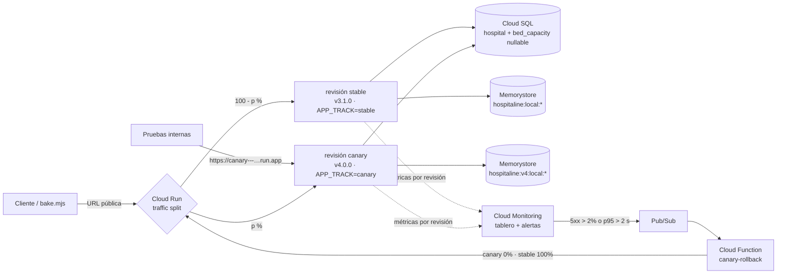

# Hospitaline

API REST para la gestión de **hospitales, doctores y pacientes**, construida con **Node.js, Fastify, TypeScript y PostgreSQL**. El proyecto incluye **Docker**, **GKE**, **Cloud SQL** y, en Seguimiento #2, reuso HTTP de entidades de otras nubes más una **caché distribuida Redis**.

- Test / staging: https://hospitaline-dev.onrender.com
- Producción: https://hospitaline.onrender.com
- GCP con Terraform (Cloud Run, Cloud SQL, Memorystore, Artifact Registry, Secret Manager): [`terraform/README.md`](terraform/README.md)

## Arquitectura multicloud

Hospitaline es la nube GCP. Consume por HTTP el último `users` de Biblio (Azure) y el último `entrenador` de Pokenetes (AWS). La caché Redis es de esta nube. La cola y Object Storage no. Neithan opera AWS, Daniela opera GCP y Phol opera Azure.


---

## Entornos y ramas

| Rama | Entorno | Coverage mínimo |
|---|---|---:|
| `dev` | Test / staging | ≥ 60% |
| `main` | Producción | ≥ 85% |

Flujo:

```text
dev → pipeline de test → Render Test
                    ↓
             merge a main
                    ↓
          pipeline de producción
                    ↓
             Render Production
```

---

## Tecnologías

- Node.js 22
- TypeScript
- Fastify
- Supabase / PostgreSQL
- Zod
- Vitest + V8 Coverage
- Docker + Docker Compose
- GitHub Actions
- Render

---

## Requisitos locales

- Node.js 22+
- npm
- Docker Desktop, si se desea ejecutar con contenedores
- Variables de entorno configuradas mediante `.env.test` y/o `.env.prod`

Puedes partir de los archivos de ejemplo:

```bash
cp .env.test.example .env.test
cp .env.prod.example .env.prod
```

Variables principales:

```text
PORT=3000
NODE_ENV=test
DB_HOST=127.0.0.1
DB_PORT=5432
DB_NAME=hospitaline
DB_USER=postgres
DB_PASSWORD=...
USERS_API_URL=http://48.217.130.84
USERS_LAST_PATH=/api/v2/users/last
USERS_LIST_PATH=/api/users
ENTRENADOR_API_URL=http://a9882c6970a5d426d9e2f19b89c56119-333357364.us-east-1.elb.amazonaws.com
ENTRENADOR_LAST_PATH=/api/v2/entrenador/last
ENTRENADOR_LIST_PATH=/entrenador
REDIS_HOST=127.0.0.1
REDIS_PORT=6379
CACHE_TTL_SECONDS=60
PEER_CACHE_TTL_SECONDS=30
ORCHESTRATOR_API_URL=
OTEL_SERVICE_NAME=hospitaline-api
OTEL_EXPORTER_OTLP_ENDPOINT=https://otlp-gateway-prod-us-east-3.grafana.net/otlp
OTEL_EXPORTER_OTLP_PROTOCOL=http/protobuf
OTEL_EXPORTER_OTLP_HEADERS=
```

`USERS_API_URL` y `ENTRENADOR_API_URL` pueden quedar vacías hasta que existan las URLs de Azure y AWS. Si un peer no está configurado o falla, `local` sigue saliendo y el peer se marca con `live: false`. Nunca se inventan datos.

## API v2 y reuso entre nubes

Hospitaline no duplica la lógica de los compañeros: consume por HTTP el último `users` de [biblio-express](https://github.com/PholCast/biblio-express) (Azure) y el último `entrenador` de [Pokenetes-API](https://github.com/Enedev/Pokenetes-API) (AWS).

### GET /api/v2/{entidad}/last

Solo el último registro **local**. Sin `peers`. Las entidades son `hospitals`, `doctors` y `pacientes`.

```bash
curl http://localhost:3000/api/v2/hospitals/last
```

```json
{
  "api": "hospitaline",
  "version": "2.0.0",
  "x-trace_id": "uuid-de-la-peticion",
  "trace-id": "id-de-grafana-sin-guiones",
  "span-id": "span-de-grafana",
  "entity": "hospital",
  "local": { "id": "...", "name": "Central" }
}
```

### GET /api/v2/{entidad}/:id

Uno local (ese id) + last en vivo de biblio-express y Pokenetes. Así salen los 3 objetos.

```bash
curl http://localhost:3000/api/v2/hospitals/UUID
```

```json
{
  "api": "hospitaline",
  "version": "2.0.0",
  "x-trace_id": "uuid-de-la-peticion",
  "trace-id": "id-de-grafana-sin-guiones",
  "span-id": "span-de-grafana",
  "entity": "hospital",
  "local": { "id": "...", "name": "Central" },
  "peers": {
    "biblio-express": { "live": true, "entity": "users", "data": {} },
    "pokenetes": { "live": true, "entity": "entrenador", "data": {} }
  }
}
```

El cliente intenta primero `.../last` y, si aún no existe, usa el listado y toma el último ítem. El header `x-trace-id` se acepta, se responde y se propaga a las APIs compañeras junto con `traceparent` (W3C).

Las APIs de los compañeros deben consumir `GET /api/v2/hospitals/last` (y opcionalmente `/api/v1/hospitals` como fallback).

`/api/v3` repite el contrato de v2 (CRUD, `/last` y peers). La diferencia es el prefijo y que `/last` y `GET /:id` responden la versión del artefacto y su track (`"version": "3.1.0", "track": "stable"`). Es la versión stable del despliegue canary. v1 y v2 siguen activas. `/api/v4` es la versión canary: no incluye `peers`. Ver [Seguimiento #3](#seguimiento-3--canary-deployments).

El orquestador de Pokenetes **aún no está conectado**. `ORCHESTRATOR_API_URL` queda vacío a propósito: él llamará a Hospitaline con esos headers; Hospitaline no lo invoca.

## Seguimiento #3 — Canary Deployments

**Proveedor:** Google Cloud. **Plataforma:** Cloud Run (servicio `hospitaline-tf-api`) con Terraform. **Observabilidad:** Cloud Monitoring nativo (tablero, alertas y métrica de negocio desde Cloud Logging).

`api/v3` (stable) y `api/v4` (canary) conviven como **dos revisiones del mismo servicio Cloud Run**, cada una con su imagen fijada por digest SHA256. Cloud Run reparte el tráfico público entre ellas por porcentaje; ambas usan el mismo Cloud SQL y el mismo Memorystore.



### Identificación de versión y track

Todas las respuestas llevan la cabecera `X-App-Version`. En `/api/v3`, `/api/v4`, `/api` y `/health` el cuerpo trae también `version` y `track`:

```http
X-App-Version: 4.0.0; track=canary
```

```json
{ "api": "hospitaline", "version": "4.0.0", "track": "canary", "entity": "hospital", "local": { "bed_capacity": 250, "capacity_band": "medium" } }
```

La versión sale del código (`src/http/release.ts`) y el track de la variable `APP_TRACK` que Terraform fija por revisión. `/api/hospitals…` es el punto de entrada para el reparto: cada imagen lo sirve con su propia versión (v3 en stable, v4 en canary).

### Cambio funcional de api/v4

Los hospitales tienen capacidad de camas: `bed_capacity` (entero ≥ 0, opcional) y el derivado `capacity_band` (`unknown` si es null, `small` < 100, `medium` < 500, `large`). v3 no los ve ni los escribe.

### Expand/Contract (datos, caché y rollback)

| Fase | Qué se hace | Estado |
|---|---|---|
| Expand | `004_expand_hospital_bed_capacity.sql`: columna **nullable** + check ≥ 0, idempotente | En este release |
| Migrar | v4 escribe `bed_capacity`; v3 sigue leyendo/escribiendo sin conocerla | En este release |
| Contract | `NOT NULL` o borrar columnas viejas, solo cuando ya no quede ninguna revisión v3 | Release futuro, nunca junto al Expand |

- El repositorio lista columnas explícitas (no `SELECT *`). Un `PUT` de v3 no envía `bed_capacity`, así que no borra la capacidad que guardó v4.
- La caché usa un prefijo por generación (`hospitaline:v4:` vs `hospitaline:`). Una escritura de v4 invalida las dos generaciones; una escritura de stable invalida solo la suya y la copia v4 expira por TTL (60 s).
- No hay colas en esta nube. El rollback solo mueve tráfico: la base queda intacta y v3 funciona con la columna nueva.

### Plan de etapas

Definido en [`canary/slo.json`](canary/slo.json) antes de desplegar:

| Etapa | Canary público | Horneado | Muestra mínima | Acceso |
|---|---:|---|---|---|
| 0 | 0% | humo (20 peticiones) | — | solo `https://canary---…run.app` |
| 1 | 10% | 2 min | 50 peticiones canary | URL pública |
| 2 | 50% | 2 min | 50 peticiones canary | URL pública |
| 3 | 100% | promovido | — | URL pública |

**Promover** si 5xx del canary ≤ 1 %, p95 ≤ 800 ms y p95 ≤ 1,5 × el p95 de stable (con piso de 100 ms para no comparar ruido). **Pausar** si la muestra es < 50 o está entre promover y abortar: el tráfico se queda donde está. **Abortar** si 5xx > 2 % o p95 > 2 s: canary 0 %, stable 100 %.

Por qué dos puertas: Cloud Run publica sus métricas con hasta 3 min de retraso, más que la observación. El **quality gate del pipeline** ([`scripts/canary/bake.mjs`](scripts/canary/bake.mjs)) genera la carga, mide en el cliente cada respuesta por track y decide al final de los 2 min. La **alerta de Cloud Monitoring** es la red de seguridad del lado servidor: si el canary se degrada fuera del pipeline (o después de promover), Pub/Sub dispara la función `canary-rollback`.

### Inyección de fallos (solo canary)

El hook de [`src/http/faultInjection.ts`](src/http/faultInjection.ts) se registra únicamente si `APP_TRACK=canary` y solo actúa sobre `/api/*`:

| Cabecera | Efecto en canary | Efecto en stable |
|---|---|---|
| `x-fault-mode: errors` | responde 500 | ninguno |
| `x-fault-mode: latency` | espera `FAULT_LATENCY_MS` (2500 ms) | ninguno |

### Pipeline

Artefactos inmutables: Artifact Registry tiene etiquetas inmutables, la imagen se etiqueta con su SemVer y Cloud Run la recibe por digest (`REPO@sha256:…`). Cada revisión se llama `hospitaline-tf-api-{track}-{versión}`: código nuevo exige subir la versión.

1. **Actions → Terraform GCP → apply** con `stable_ref=v3.1.0`: infraestructura + stable al 100 %.
2. **Actions → Canary GCP (api/v4)**:
   - `stage=rollout`, `fault_mode=none`: 0 → 10 → 50 → 100 con observación y gate (**promoción exitosa**).
   - `stage=rollout`, `fault_mode=errors` o `latency`: el gate de la etapa 1 aborta y deja el canary en 0 % (**rollback**).
   - `stage=0|1|2|3|rollback`: una etapa suelta.
3. Para consolidar v4 como nueva stable: **Terraform GCP → apply** con `stable_ref=v4.0.0`.

Local (desde `terraform/`, con las `TF_VAR_*` exportadas): `../scripts/canary/rollout.sh rollout`.

### Tablero

`terraform output dashboard_url` → **Monitoring → Dashboards → "Hospitaline: stable (v3) vs canary (v4)"**. Cada gráfica separa las revisiones: tráfico, 5xx, 4xx, latencia p50/p95/p99, CPU, memoria, instancias, hospitales registrados por track y el estado de las dos alertas. **Cloud Run → hospitaline-tf-api → Revisiones** muestra el porcentaje asignado.

### Demostración en vivo

```bash
cd terraform
URL="$(terraform output -raw api_url)"; CANARY="$(terraform output -raw canary_url)"

# (a) canary al 0 %: solo por su URL con tag
curl -si "$CANARY/api/v4/hospitals/last" | grep -i x-app-version

# (b) reparto real por porcentaje
for i in $(seq 1 200); do curl -s -o /dev/null -D - "$URL/api/hospitals/last" | grep -i x-app-version; done | sort | uniq -c

# (d) fallo inyectado: solo el canary responde 500
curl -si -H 'x-fault-mode: errors' "$URL/api/hospitals/last" | grep -iE '^HTTP|x-app-version'
```

## Observabilidad (Integrante B, GCP)

Daniela no administra Grafana. Expone **`GET /metrics`** (Prometheus) para que el compañero scrape el tablero unificado. Cloud Monitoring / Cloud Logging cubren la nube nativa. Guía: [`observability/README.md`](observability/README.md).

```text
OTEL_SERVICE_NAME=hospitaline-api
OTEL_EXPORTER_OTLP_ENDPOINT=https://otlp-gateway-prod-us-east-3.grafana.net/otlp
OTEL_EXPORTER_OTLP_PROTOCOL=http/protobuf
OTEL_EXPORTER_OTLP_HEADERS=
```

`OTEL_EXPORTER_OTLP_HEADERS` vive en el secreto `hospitaline-otel`, no en git.

## Caché distribuida

Este es el artefacto de la nube GCP (Integrante B): Redis con TTL e invalidación.

| Qué se cachea | Clave | TTL | Invalidación |
|---|---|---|---|
| Hospital / doctor / paciente por id | `hospitaline:v4:local:{entidad}:{id}` (v3: `hospitaline:local:…`) | `CACHE_TTL_SECONDS` (60s) | POST, PUT, PATCH, DELETE |
| Último registro local | `hospitaline:v4:local:{entidad}:last` (v3: `hospitaline:local:…`) | 60s | POST, PUT, PATCH, DELETE |
| `users` de biblio-express | `hospitaline:peer:biblio-express:users:last` | `PEER_CACHE_TTL_SECONDS` (30s) | solo TTL |
| `entrenador` de Pokenetes | `hospitaline:peer:pokenetes:entrenador:last` | 30s | solo TTL |

Los fallos de un peer (`live: false`) **no** se cachean, para reintentar en la siguiente petición. Si Redis no está configurado, la API usa una caché en memoria del proceso.

Health check con estado de caché:

```bash
curl http://localhost:3000/health
```

Local con Redis:

```bash
docker compose up --build
```

En GKE aplica primero `k8s/redis.yaml` y luego el deployment. `REDIS_HOST=redis` apunta al Service del clúster. El mismo cliente es compatible con Memorystore si más adelante se cambia el host.

```text
k8s/redis.yaml
k8s/deployment.yaml
```

---

## Cómo ejecutar localmente

Instalar dependencias:

```bash
npm install
```

Desarrollo con recarga automática:

```bash
npm run dev
```

Compilar TypeScript:

```bash
npm run build
```

Ejecutar la versión compilada:

```bash
npm start
```

La API queda disponible en:

```text
http://localhost:3000
```

Health check:

```bash
curl http://localhost:3000/health
```

---

## Tests y Coverage

Los tests y la generación de coverage están desactivados temporalmente. No forman parte
de los scripts de `npm`, Docker Compose ni los pipelines activos.

---

## Docker

El proyecto tiene:

| Archivo | Función |
|---|---|
| `Dockerfile` | Construye la imagen de la API |
| `docker-compose.yml` | Ejecuta la API |

El `Dockerfile` utiliza varias etapas:

```text
node:22-alpine
      ↓
instalación de dependencias
      ↓
compilación TypeScript
      ↓
imagen final con dist/
```

La imagen final ejecuta:

```bash
node dist/server.js
```

Construir la imagen:

```bash
docker build -t hospitaline-api .
```

Ver imágenes:

```bash
docker images
```

Ejecutar la imagen directamente:

```bash
docker run --rm --env-file .env.test -p 3000:3000 hospitaline-api
```

---

## Docker Compose

`docker-compose.yml` define dos servicios:

```text
api
tests
```

### API

Construye la imagen mediante el `Dockerfile` y expone:

```text
localhost:3000
```

Levantar los servicios:

```bash
docker compose up --build
```

O en segundo plano:

```bash
docker compose up --build -d
```

Ver servicios:

```bash
docker compose ps
```

Ver logs:

```bash
docker compose logs
```

Detener:

```bash
docker compose down
```

### Tests dentro de Docker

El servicio `tests` utiliza `node:22-alpine`, monta el proyecto y ejecuta:

```text
npm ci
npm run test:coverage
```

Ejecutarlo:

```bash
docker compose run --rm tests
```

Solo tests:

```bash
docker compose run --rm tests npm test
```

Tests con coverage:

```bash
docker compose run --rm tests npm run test:coverage
```

Comprobar coverage ≥ 60%:

```bash
docker compose run --rm tests npm run coverage:check:60
```

Comprobar coverage ≥ 85%:

```bash
docker compose run --rm tests npm run coverage:check:85
```

El parámetro `--rm` elimina el contenedor temporal al terminar.

---

## Endpoints

Las rutas están agrupadas bajo:

```text
/api/v1
```

| Método | Ruta | Descripción |
|---|---|---|
| `GET` | `/health` | Health check + estado de la caché |
| `GET` | `/api/v1/hospitals` | Listar hospitales |
| `GET` | `/api/v1/hospitals/:id` | Obtener hospital |
| `GET` | `/api/v2/hospitals/last` | Último hospital local, sin peers |
| `GET` | `/api/v2/hospitals/:id` | Hospital local + last de `users` y `entrenador` |
| `GET` | `/api/v2/doctors/last` | Último doctor local, sin peers |
| `GET` | `/api/v2/doctors/:id` | Doctor local + last de `users` y `entrenador` |
| `GET` | `/api/v2/pacientes/last` | Último paciente local, sin peers |
| `GET` | `/api/v2/pacientes/:id` | Paciente local + last de `users` y `entrenador` |
| `GET` | `/api/v3/hospitals/last` | Igual que v2, con `version` y `track` del artefacto |
| `GET` | `/api/v3/hospitals/:id` | Igual que v2, con `version` y `track` del artefacto |
| `POST` | `/api/v3/hospitals` | Crear hospital en la versión 3 (ignora `bed_capacity`) |
| `GET` | `/api/v4/hospitals/last` | Como v3 + `bed_capacity` y `capacity_band` |
| `POST` | `/api/v4/hospitals` | Crear hospital con `bed_capacity` opcional |
| `GET` | `/api/hospitals/last` | Alias de la versión propia de cada imagen (v3 en stable, v4 en canary) |
| `POST` | `/api/v1/hospitals` | Crear hospital |
| `PUT` | `/api/v1/hospitals/:id` | Reemplazar hospital |
| `PATCH` | `/api/v1/hospitals/:id` | Actualizar parcialmente |
| `DELETE` | `/api/v1/hospitals/:id` | Eliminar hospital |
| `QUERY` | `/api/v1/hospitals/query` | Consultar hospitales |
| `GET` | `/api/v1/doctors` | Listar doctores |
| `GET` | `/api/v1/doctors/:id` | Obtener doctor |
| `POST` | `/api/v1/doctors` | Crear doctor |
| `PUT` | `/api/v1/doctors/:id` | Reemplazar doctor |
| `PATCH` | `/api/v1/doctors/:id` | Actualizar parcialmente |
| `DELETE` | `/api/v1/doctors/:id` | Eliminar doctor |
| `QUERY` | `/api/v1/doctors/query` | Consultar doctores |
| `GET` | `/api/v1/pacientes` | Listar pacientes |
| `GET` | `/api/v1/pacientes/:id` | Obtener paciente |
| `POST` | `/api/v1/pacientes` | Crear paciente |
| `PUT` | `/api/v1/pacientes/:id` | Reemplazar paciente |
| `PATCH` | `/api/v1/pacientes/:id` | Actualizar parcialmente |
| `DELETE` | `/api/v1/pacientes/:id` | Eliminar paciente |
| `QUERY` | `/api/v1/pacientes/query` | Consultar pacientes |

### Ejemplos

Health check:

```bash
curl http://localhost:3000/health
```

Listar hospitales:

```bash
curl http://localhost:3000/api/v1/hospitals
```

Crear hospital:

```bash
curl -X POST http://localhost:3000/api/v1/hospitals \
  -H "Content-Type: application/json" \
  -d '{"name":"Hospital Central","address":"Calle 10","city":"Medellín","phone":"6041234567"}'
```

Obtener por ID:

```bash
curl http://localhost:3000/api/v1/hospitals/UUID
```

Actualizar parcialmente:

```bash
curl -X PATCH http://localhost:3000/api/v1/hospitals/UUID \
  -H "Content-Type: application/json" \
  -d '{"city":"Cali"}'
```

Eliminar:

```bash
curl -X DELETE http://localhost:3000/api/v1/hospitals/UUID
```

---

## Flujo de la API

Una petición sigue esta estructura:

```text
Cliente HTTP
    ↓
Fastify
    ↓
Routes
    ↓
Controllers
    ↓
Services
    ↓
Repositories
    ↓
Supabase
    ↓
PostgreSQL
```

- **Routes:** definen las rutas y métodos HTTP.
- **Controllers:** reciben la petición, validan datos y generan la respuesta.
- **Services:** contienen las reglas de negocio.
- **Repositories:** realizan las operaciones sobre Supabase.
- **Supabase:** proporciona el acceso a PostgreSQL.

Fastify es el framework encargado de recibir las solicitudes HTTP y dirigirlas al controlador correspondiente.

---

## Base de datos

La estructura de la base de datos se encuentra en:

```text
migrations/
├── 001_create_hospital.sql
├── 002_create_doctor.sql
├── 003_create_paciente.sql
└── 004_expand_hospital_bed_capacity.sql   # Expand de api/v4
```

Las entidades principales son:

```text
Hospital
 ├── Doctor
 └── Paciente
       └── Doctor
```

La aplicación utiliza Supabase para acceder a PostgreSQL.

---

## GitHub Actions (CI/CD)

Existen dos workflows:

```text
.github/workflows/
├── test-pipeline.yml
└── prod-pipeline.yml
```

### Test

Se ejecuta con cambios en `dev` y Pull Requests hacia `dev`.

```text
Checkout
 ↓
Node 22
 ↓
npm ci --force
 ↓
npm run build
 ↓
npm run test:coverage
 ↓
coverage ≥ 60%
 ↓
Deploy Hook de Render
```

### Producción

Se ejecuta con cambios en `main`.

```text
Checkout
 ↓
Node 22
 ↓
npm ci --force
 ↓
npm run build
 ↓
npm run test:coverage
 ↓
coverage ≥ 85%
 ↓
Deploy Hook de Render
```

Si fallan los tests o no se alcanza el coverage mínimo, el despliegue no continúa.

Los secretos de Supabase y Render se almacenan en **GitHub Secrets**.

---

## Render

Los servicios desplegados son:

- Test / staging: https://hospitaline-dev.onrender.com
- Producción: https://hospitaline.onrender.com

Health check:

```bash
curl https://hospitaline-dev.onrender.com/health
curl https://hospitaline.onrender.com/health
```

Ejemplo de endpoint:

```bash
curl https://hospitaline.onrender.com/api/v1/hospitals
```

La configuración detallada de Render se encuentra en [`RENDER_SETUP.md`](RENDER_SETUP.md).

---

## Estructura principal

```text
src/
├── app.ts
├── server.ts
├── observability/
├── bootstrap/
├── cache/
├── config/
├── controllers/
├── db/
├── errors/
├── integrations/
├── plugins/
├── repositories/
├── routes/
├── services/
└── types/

observability/
grafana/
k8s/

tests/
├── integration/
└── unit/

migrations/
scripts/
.github/workflows/

Dockerfile
docker-compose.yml
package.json
vitest.config.ts
tsconfig.json
```
